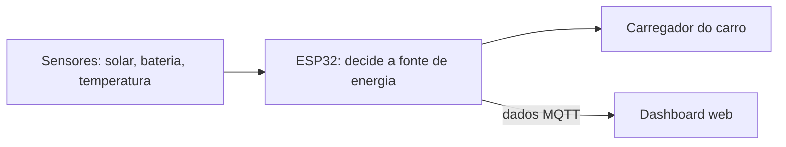

# VoltStation

Estação de recarga de veículos elétricos com energia solar e monitoramento inteligente.
**Sprint 4 · Desafio GoodWe · FIAP**

- Vídeo: https://youtu.be/wNOUO5Z3iDE
- Wokwi: https://wokwi.com/projects/478455549354986497

---

## Equipe

| Nome | RM |
|---|---|
| Carlos Eduardo Tavares | 572949 |
| Rafael Lins | 570588 |
| Rafael Gandolfi | 569036 |
| Cauã Paes | 569906 |
| Guilherme Miranda | 573107 |
| João Pedro Soler | 569725 |

---

## O problema

Muita gente carrega o carro elétrico à noite, no horário de pico, quando a energia é mais cara. Ao mesmo tempo, quem tem painéis solares desperdiça o excedente gerado durante o dia.

## A solução

A VoltStation escolhe sozinha de onde vem a energia para carregar o carro:

1. **Sol**, se houver excedente de geração
2. **Bateria**, se estiver no horário de pico
3. **Rede**, só fora do horário de pico

Um dashboard web mostra em tempo real a geração, a bateria, a recarga e o CO₂ evitado.

---

## Arquitetura

- **ESP32 (Wokwi):** lê os sensores, decide a fonte de energia e liga o carregador.
- **Dashboard web:** mostra os dados em gráficos.

---

## Tecnologias GoodWe

| Equipamento GoodWe | O que faz na solução |
|---|---|
| Inversor híbrido | Gerencia painéis, bateria e rede |
| Bateria Lynx Home | Guarda a energia solar para usar à noite |
| Carregador de VE (HCA) | Carrega o carro |
| Plataforma SEMS | Monitoramento, que é a mesma ideia do nosso dashboard |

Na simulação, o ESP32 faz o papel do inversor.

---

## Alinhamento com o desafio e a disciplina

- **Energia renovável:** a energia solar sempre tem prioridade.
- **Armazenamento:** a bateria é usada no horário de pico.
- **Monitoramento:** o dashboard funciona em tempo real.
- **Conteúdos da disciplina:** IoT (ESP32 e sensores), lógica de programação e desenvolvimento web.

---

## Resultados (simulados)

Cenário: painel de 10 kWp e carro rodando 50 km por dia (7,5 kWh por dia).

| Indicador | Resultado |
|---|---|
| Geração solar | ~45 kWh/dia |
| Recarga com energia solar ou da bateria | ~100% |
| Uso da rede no horário de pico | 0 |
| CO₂ evitado em relação a um carro a gasolina | ~3,5 t/ano |

---

## Sustentabilidade e inovação

**Benefícios:** menos emissões, menos sobrecarga na rede e menor custo para o usuário.
**Diferenciais:** decisão automática, dashboard em tempo real e indicador de CO₂.
**Limitações:** o projeto é simulado, e o custo de painéis e bateria ainda é alto.

---

## Ferramentas

ESP32 · Wokwi · C++ (Arduino) · HTML · CSS · JavaScript · GitHub

## Referências

- GoodWe: https://www.goodwe.com
- Wokwi: https://docs.wokwi.com
- CRESESB (dados solares): https://cresesb.cepel.br
